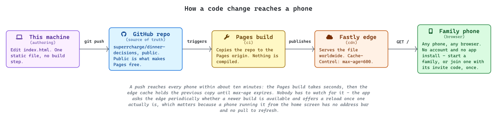

# Dinner Decisions

A one-page dinner picker for families.
Everyone in the house opens it on their own phone, taps the meals they'd be happy to eat this week, and whoever does the shopping sees a live tally.

**→ [dinnerdecisions.app](https://dinnerdecisions.app/)**

It used to live at superrcharge.github.io/dinner-decisions.
That address now only hands each phone over to the new one, in the same family and as the same person (see [Moving from GitHub Pages](#moving-from-github-pages)).

No accounts to create, nothing to install, no email. Any phone, any browser. Free.

Anyone can start a family from the welcome screen.
Starting one hands back an invite code and link to send to the rest of the house.
A phone joins once, by opening the link or typing the code, and is remembered from then on.
A stranger who finds the URL can start a family of their own, and can see nothing of anyone else's.

## How it works

- **Pick meals** - tap tiles to vote. Everything you've chosen is gathered into a **Your picks** strip at the top, so you can read your own selections back without hunting for green tiles. Type anything that isn't on the list and it joins that week's options straight away.
- **Shopping** - meals ranked by votes, with who picked each one and who hasn't voted yet. Build the week's plan by tapping *Add*.
- **Manage** - hidden behind its own separate code, not the family one. Edit the master meal list, keep or dismiss what the family suggested, set a meal's icon, list what a meal needs, clear the week.

The tab strip sticks to the top of the screen, so the three views stay reachable however far down the list you've scrolled.

The week rolls over on its own every Sunday. Nobody has to reset anything.

## Starting and joining

**Starting a family:** tap **Start a family**, give the family a name and yourself a first name, and tap **Create**.
The phone that starts a family has Manage unlocked, and is shown the invite straight away.
A new family's meal list is empty, so the Pick tab offers **Add starter meals**: sixteen common dinners, written exactly as if they had been typed into Manage, to rename or remove at will.

**Inviting:** the invite is a 10-character code such as `X3UHC-636A8`, and a link that carries it.
**Share invite** opens the phone's own share sheet where there is one and copies the message otherwise.
The invite is reachable afterwards from the name menu (**Invite someone**) and from **Manage → Your family**.
Codes never use `0`, `O`, `1`, `I` or `L`, so one read aloud cannot be mistyped into another.

**Joining:** open the link, or tap **I have a code** and type it.
Case, spaces and the dash do not matter, and pasting the whole link into the box works too.
The phone then asks who is picking, as it always has.

On an iPhone, a link opened from a message lands in Safari, which keeps its storage apart from a copy installed on the home screen.
A home-screen copy therefore needs the code typed into it once, which is why the code is shown in a form that is easy to type.

**Changing the code:** **Manage → Your family → New code**.
The old code stops working at once; phones already in the family stay in.

**Leaving:** the name menu's **Leave** link takes this phone out of the family and clears what it had cached.
Everyone else keeps everything, and coming back needs the invite code.

**Removing a name:** **Manage → Who's in the house → Remove**, confirmed once.
It deletes the name and every vote made under it, this week's and earlier ones, on every phone.

**Deleting:** **Manage → Delete this family**, confirmed by typing the family's name.
It removes every meal, vote, name, ingredient and invite for everyone.
Other phones notice within a second or two and return to the welcome screen with a line saying why.

A phone whose family has gone, or that has been removed from it, says so and returns to the welcome screen rather than sitting on an empty list.

## Grocery list

Meals can carry a list of ingredients, and the week's plan turns them into one list to shop from.

**Adding them** - in **Manage**, tap anywhere on a meal's row to open it, and tap again to close. **+ Ingredient** does the same but puts the cursor straight in the box. The small number beside a meal's name is how many it already has, so you can read the list without opening anything. Nothing is shown until you tap, so the tab stays as quiet as it was before.

A meal holds up to 20 ingredients. That is roughly double a long recipe - it is a guardrail, not a target.

**Shopping from it** - the **Shopping** tab shows a **To buy** list under the week's plan, built from whatever is locked in. It only appears for someone who has entered the Manage code, because they are the one doing the shopping. Everyone else sees the plan exactly as before.

Ingredients needed by more than one meal are merged and the list says which meals they are for. Items only one meal needs are left unannotated, so the list stays short.

**What the merge does and does not do.** Two ingredients merge when their text matches exactly, ignoring case and surrounding spaces - so `Onion` and `onion` become one line. It is plain text matching, so `onion` and `onions` stay separate, and so do `chicken` and `2 lbs chicken`. Being consistent in how you type them is what keeps the list tidy; the app will not guess.

Planned meals with nothing listed yet are named beneath the list, so a short list explains itself.

**Sending and printing it** - the round share button beside **This week's plan**, and the one beside **To buy**, open the phone's own share sheet (Messages, other apps, Copy) with the plan or the list as plain text.
Where there is no share sheet the text is copied instead, and the button shows a tick.
The print button beside **To buy** prints just the list, black on white, in two columns with a box to tick beside each item; on a computer it also saves as a PDF.
Each page carries only the time it was printed, top right, and "Dinner Decisions", bottom left: the page leaves no margin for the browser's own header and footer (date, page title, web address), so Chrome and Edge leave them out.
On iPhone and iPad it opens the share sheet with that list as a PDF instead, because a home-screen web app there ignores the page's print command; the sheet's own **Print** prints it, and Save to Files or Messages work too.

**Not built: ticking things off as you shop.** Deliberately left out for now rather than overlooked. It needs somewhere to keep per-week checked state that every phone can see, which means new Firestore documents and a rules change - worth doing only once the list has been shopped with a few times and it is clear what is actually wanted.

## Installing it on a phone

Safari: share menu → *Add to Home Screen*. Chrome: ⋮ → *Add to Home screen*.

It installs as **Dinner Decisions** with a pot icon and opens without browser chrome, so it behaves like an app rather than a bookmark.

That has one consequence worth knowing: a page running standalone has **no address bar and no pull-to-refresh**. That's why the bottom bar carries a **Reload** button, and why a green *"A newer version is ready"* strip appears on its own when new code has shipped. Without those, the only way to update would be to force-quit the app.

The version check deliberately asks for the same copy a reload would get, rather than going straight to the origin. Querying the origin would let it announce a version that a reload can't actually fetch yet - so it would prompt, you'd reload, nothing would change, and it would prompt again.

## How a meal gets its icon

Icons aren't stored and aren't looked up - they're worked out in the browser from the meal's name every time a tile renders.

1. A keyword table maps names to glyphs, most specific first, so *Chicken Alfredo* matches `alfredo` (🍝) before it reaches `chicken` (🍗).
2. Anything unmatched falls back to a neutral 🍴.
3. **Manage → Icon** overrides it: paste any emoji and it's written to that meal's `icon` field, which wins over the matcher and reaches every phone in about a second.

The override is the normal way to fix a glyph - it needs no code change and no deploy. Editing the keyword table only makes sense for a whole category that keeps recurring.

The Icon button appears on meals in the master list, not on pending suggestions, so *Keep* one first and then set its icon.

## Legal pages, deletion requests and search

`privacy.html`, `terms.html`, `delete.html` and `accessibility.html` are linked under the welcome card (the homepage link to the privacy policy that California's CalOPPA expects) and from the help screen.
Their HTML comments are notes for the lawyer and for later work; `scripts/build-site.mjs` strips them from what is served.

**Announcing a change.** The policy and terms promise a notice in the app before a change that matters takes effect.
Publish the new pages with an effective date about two weeks ahead, then change `currentPolicy()` in `index.html` to the new version and date.
Every phone in a family then shows one line saying the policy was updated, with links, until someone taps **OK** on it.

**Deletion requests by email.** Someone who has lost access to their family can ask hello@dinnerdecisions.app to delete it.
The private `admin/delete-family.mjs` finds the family by name or invite code, lists what it would delete, and deletes it with `--apply`; its header is the runbook, including how to check the request really comes from that family.

**Search.** `robots.txt` lets every crawler in and points at `sitemap.xml`, which lists every public page.
`index.html` carries the page title and description shown in search results, a canonical link to `dinnerdecisions.app`, structured data describing the app, and the link preview card (Open Graph tags and `icons/og-image.png`) shown when a link is texted or posted.
Google Search Console, verified by a DNS record at Cloudflare, shows which searches find the site without adding any tracking to it.

## How it's put together

Two moving parts that never talk to each other: Firebase Hosting serves the code, Firestore holds the data, and the page in the browser is the only thing that touches both.

<picture>
  <source media="(prefers-color-scheme: dark)" srcset="./diagrams/runtime-dark.svg">
  
</picture>

Deploying a change is `mise run site-deploy`.
It copies only the files the site serves (`index.html`, the legal pages, the manifest and icons) into `dist/` with `scripts/build-site.mjs`, and releases them to Firebase Hosting.
A page is published only once it is listed in that script, and the review notes the legal pages carry as HTML comments are stripped on the way out.
Every response is `Cache-Control: no-cache`, so the app's update check and a reload always see the newest release.

<picture>
  <source media="(prefers-color-scheme: dark)" srcset="./diagrams/hosting-dark.svg">
  
</picture>

### Moving from GitHub Pages

The app lived on GitHub Pages until November 2026, and GitHub's rules do not allow Pages to host a paid service, so it moved to Firebase Hosting on its own domain.
A new address is a new origin, which means a phone's saved family, name and anonymous sign-in do not carry over by themselves.

So the same `index.html` behaves differently on the old address (`OLD_HOST`): instead of connecting, it reads the phone's family, the person it picks as, whether Manage is unlocked, and the family's invite code, which members can read, and sends them to `dinnerdecisions.app` after a `#move=`.
The fragment never reaches a server.
The new address joins that family with the code, picks the same person, deletes the old address's member record so the device count stays honest, and clears the fragment.
A phone that is already in a family ignores a `#move=` link, so a crafted link cannot pull it out of its family.
An invite link sent before the move still works: the old address forwards its code.

An iPhone gives a home-screen app storage of its own, separate from Safari, so the old icon cannot hand over to a new icon directly.
There the old icon waits for a tap that opens Safari, which joins as above and shows the family's code to type once in the new icon.

The legacy GitHub Pages build still publishes from `main`, so a push updates the hand-over page.
`tests/e2e/move.spec.mjs` covers all of it, with `localhost` as the old address and `127.0.0.1` as the new one.

## Firebase

Project **`dinner-decisions-6af97`**.

<picture>
  <source media="(prefers-color-scheme: dark)" srcset="./diagrams/firebase-dark.svg">
  
</picture>

Two products are switched on and the rest are deliberately off:

| Product | State | Why |
|---|---|---|
| Cloud Firestore | on | the shared data, with realtime listeners |
| Anonymous Authentication | on | gives every visitor an identity without an account |
| Firebase Hosting | on | serves the app at dinnerdecisions.app |
| Cloud Functions | **off** | there is no server-side logic |

**Anonymous auth** means nobody signs up and nobody has a password. On first load the SDK silently mints an identity for that browser and hands back a token. It exists so the rules have something to check - it is not a login, and it does not identify a *person*. Which family member a phone is picking as is a separate thing entirely, chosen from the roster and remembered in that device's `localStorage`.

An anonymous identity on its own buys nothing, though. See below.

### Who gets in

The site is public and always will be - anyone can open the address, and making the repo private would only hide the source, not the URL.
So the gate is in the data, not in the hosting.

Three things do the work:

- The **household id** is 20 random characters, so it cannot be guessed and two families with the same surname never meet.
- The **invite code** is what admits a device. It lives in `households/<hid>/private/join`, readable only by devices already in that family.
- **`invites/<code>`** is a lookup from a code to the household it opens, and nothing more. It can be fetched by id but never listed, so holding a code is the whole of the permission.

The sequence on a cold phone joining:

1. Firebase mints an anonymous uid.
2. The typed code is normalised, and the app reads `invites/<code>`. Missing means *"No family uses that code"* - a real error rather than a silent empty list.
3. The code goes up with a write to `households/<hid>/members/<uid>`. The page never checks it; the rules compare it against `private/join`, which the phone cannot read until that write has succeeded. Rejected means the code was replaced since the invite was found.
4. It matches, the member document is created, and the app connects. It never asks again on that phone.

Every data collection is gated on that member document existing, not on the code.
So a new code changes nothing for phones already in, because their membership is the document.

Starting a family is one batched write of four documents: the household, `private/join`, the invite, and the creator's own membership.
The rules refuse the household unless all four arrive together, so no family can exist half made, with nobody in it, or with no way to invite anyone.
The code must be 10 characters from the code alphabet; the rules check that too, because they cannot count attempts and so the code has to be unguessable instead.

The rules do not distinguish between members.
Anyone in a family can edit its meals, change its code, remove a phone, or delete it - the intended shape for a household.
`MANAGE_PIN` in `index.html` is still only a UI gate: it keeps the Manage tab off the other family members' phones and defends nothing, and it is the same for every family.

The uid lives in the browser's IndexedDB, so clearing site data means joining with the code once more.

### What a write may carry

Strangers now hold valid tokens, so every data collection names the fields a document may have (`keys().hasOnly`) and bounds each one.
Lists are checked to be lists of strings, bounded in count and in total length.
That stops anyone padding a document to a megabyte under a field nobody reads, or storing a value that would break the page for the rest of their family.

A meal's `icon` is the one field drawn as a glyph rather than as text, and it once went into the page unescaped, which let anyone in a family run script on everyone else's phone by setting an icon to markup.
The page now escapes it like everything else, and the rules refuse `<`, `>`, `&` and `"` in it as a second lock.

### The family from before invites

`charge` predates all of this: its id is a surname slug, and its code was short with no `invites` document.
Nothing treats it specially.
Its phones are members like any other, and the first time one of them opens an invite, the app replaces the short code with a strong one and creates its invite.
Until that happens, a new phone has no code it can join `charge` with.

### Leftovers from the migration

> **One-time. Delete this section once it is done.**

Before the household gate, everything lived in top-level `meals`, `suggestions`, `people`, `votes` and `weeks` collections. The migration copied all 62 documents into `households/charge/` and left the originals in place deliberately, as a fallback while phones were still joining. Nothing reads them now.

Once every phone has joined and is working, remove them: **Firestore → Data**, then for each of those five collections, open it and use **Delete collection**.

Leave `households` alone - that is the live data.

### Deploying the rules

```bash
mise run rules-test     # every rule, against the local emulator
mise run rules-deploy   # publish firestore.rules to the live project
```

Pushing to GitHub does not change the rules; `rules-deploy` does.
It needs `firebase login` once on the machine, and nothing else - no service account key is stored anywhere.
Publish rules before the page that depends on them; the rules here are written to stay compatible with the page that is live while they go out.

`create`/`update` and `delete` are written as separate clauses on purpose: a delete carries no `request.resource`, so a single combined rule with a field check silently blocks every delete - removing a meal, dismissing a suggestion, clearing a week.

### App Check

The page gets an App Check pass from Google with an invisible reCAPTCHA Enterprise key, so nobody ever sees a checkbox, a puzzle or a badge.
The pass renews every hour and rides along with every Firestore request, so the project can tell the real page on its own addresses from a script that copied the public config.
The reCAPTCHA key allows dinnerdecisions.app, www.dinnerdecisions.app, the two Firebase Hosting addresses and superrcharge.github.io (the old address still reads a family's code during the hand-off).
Firestore runs it watch-only since Nov 18, 2026: the console counts requests with and without a pass and refuses none.
Once nearly all requests pass, turn on enforcement for Cloud Firestore under App Check in the Firebase console.
Enforcement also waits for the store apps: they cannot pass reCAPTCHA (they run at localhost) and need native App Check (Play Integrity, App Attest) first.
The page skips App Check under the emulator, which has no reCAPTCHA.

### Cost

The project is on the pay-as-you-go Blaze plan, with the same free allowances as before: 1 GiB of storage, 50,000 reads and 20,000 writes a day.
Opening the app costs roughly one read per meal, person and vote, so on the order of a hundred; at the current size the bill is $0.
A monthly budget of $25 emails alerts at $5, $12.50, $22.50 and $25, and when Google forecasts the month will pass $25.

### Backups

Google backs the database up every day and keeps each backup for 7 days (a Firestore backup schedule).
A second copy is made every morning onto the home NAS by the private `admin/backup.mjs`, kept 30 days, and `admin/restore.mjs` puts one family or everything back from it.
Delete protection is on, so the database itself cannot be deleted by accident.
The privacy policy and the deletion page say how long backups keep data; change them together if either retention changes.

### Recreating it from scratch

1. Create a Firebase project (skip Analytics).
2. **Firestore Database → Create database**, production mode, any US region.
3. **Authentication → Sign-in method → Anonymous → Enable.**
4. **Project settings → Your apps → `</>`** and copy the config into `FIREBASE_CONFIG` in `index.html`.
5. Put the project id in `.firebaserc`, then `firebase login` and `mise run rules-deploy`.
6. Restrict the web API key: **Google Cloud Console → APIs & Services → Credentials**. Application restrictions → Websites → `dinnerdecisions.app/*`, the two Firebase Hosting defaults (`dinner-decisions-6af97.web.app/*`, `dinner-decisions-6af97.firebaseapp.com/*`) and, while it still hands phones over, `superrcharge.github.io/*`. API restrictions → only Identity Toolkit, Token Service, Cloud Firestore, Firebase Installations and Firebase App Check.
7. App Check: create a reCAPTCHA Enterprise score key (website, the addresses above without the store apps' localhost), register it under **App Check → Apps** with a 1 hour token, and put its site key in `APP_CHECK_SITE_KEY`.

No household needs creating by hand; the first one is started from the app.

## Firestore data model

Everything hangs off a household, so the app touches only two top-level collections:

| Path | Document id | Holds |
|---|---|---|
| `invites` | the invite code | `hid`, `createdAt`. `get` for any signed-in device; **`list` is denied**. Created only alongside the household's real code, and replaced whenever the code is |
| `households` | 20 random characters (`charge` is a surname slug from before) | `name`, `createdBy`, `createdAt`. `get` is allowed so a joining phone can show the family's name; **`list` is denied**, so the ids cannot be enumerated |
| `households/<hid>/private` | `join` | one field, `code`. Readable by members only; written only with its invite. Any other document under `private/` is closed to every client |
| `households/<hid>/members` | anonymous uid | `code`, `joinedAt`. One per admitted device; never editable. Deleted to leave, or by another member to remove a phone |
| `households/<hid>/meals` | slug of the name | the master list. Optional `icon` field overrides the matched emoji; optional `ingredients` array of up to 20 strings feeds the grocery list |
| `households/<hid>/suggestions` | slug of the name | typed-in meals awaiting keep or dismiss |
| `households/<hid>/people` | slug plus a random suffix | the household roster |
| `households/<hid>/votes` | `<weekId>__<personId>` | one document per person per week, holding an array of meal ids |
| `households/<hid>/weeks` | `<weekId>` | the meals locked into that week's plan |

`allow list: if false` on `households` and on `invites` are the most load-bearing lines in `firestore.rules`.
Without the first, one query returns every household id in the project; without the second, every code.

`weekId` is the Sunday of the week, as `YYYY-MM-DD`.

A suggestion is given the same id its meal will have, so approving one is a copy across collections and existing votes keep pointing at the right thing.

One document per voter per week means two phones never contend on the same write, which matters because Firestore is last-writer-wins with no transactions.

## Layout

The app is a single static file, `index.html`, with no build step - open it and it works.
`package.json` holds the test and deploy tooling only; nothing in it ships to a phone.

```
index.html            the whole app
privacy.html, terms.html, delete.html, accessibility.html
                      the legal pages, linked from the welcome and help screens
robots.txt, sitemap.xml  for search engines; add new public pages to the sitemap
site.webmanifest      home-screen name and icons
firestore.rules       the security rules; mise run rules-deploy publishes them
firebase.json         emulator ports, the rules file and Hosting headers
scripts/build-site.mjs  copies the served files into dist/ for Hosting
tests/rules.test.mjs  every rule against the emulator, negative cases first
tests/e2e/            two- and three-phone browser tests, and screenshots
tests/live/           a smoke test of the deployed site; mise run live-check
tests/serve.mjs       a static server with an ETag, like the real host
icons/                home-screen and favicon PNGs, generated from icon.typ,
                      and og-image.png, the link preview card, from og.html
diagrams/             Typst sources and rendered SVGs
  design/             palette and tokens shared by every diagram
```

## Testing

```bash
npm install                    # once
npx playwright install chromium # once
mise run rules-test            # security rules against the Firestore emulator
mise run e2e                   # phones in a browser against the emulators
```

`mise` installs the Java the emulator needs, locally to this project.
Both suites run against the Firebase emulators under the throwaway project id `demo-dinner-decisions`, so no test ever touches a real family.
The page joins the emulators only when served from `localhost` with `?emu=1`; the live site cannot take that path.
The browser tests write screenshots of every screen, light and dark, at two phone widths, to `test-results/screens/`.
GitHub Actions runs both suites on every push.

The emulators use ports 8181 and 9199 rather than the defaults, which other local projects tend to hold.

After a deploy, `mise run live-check` runs one test against the real site and the real database.
Two phones start a throwaway family, join it by its link, vote and see the tally, then delete it, and the test reads Firestore as the project owner to confirm nothing was left behind.
It needs `firebase login` on the machine, so it is not part of CI, and it never opens or touches an existing family.

## Configuration

Three things in `index.html`:

- `FIREBASE_CONFIG` - the web app config from the Firebase console. The `apiKey` is not a secret; it identifies the project, and it ships to every browser that loads the page whatever the repo's visibility. It is restricted in Google Cloud to the site's own addresses and to the five services the page uses (sign-in and its tokens, Firestore, Firebase Installations and App Check), and access to the data is controlled by the security rules. GitHub's secret scanner flags it anyway, because it cannot tell a Firebase browser key from a server-side Google key.
- `APP_CHECK_SITE_KEY` - the reCAPTCHA Enterprise site key App Check uses (see [App Check](#app-check)). Like the `apiKey`, it is public by design.
- `MANAGE_PIN` - the code that reveals the Manage tab, the same for every family and shown inside Manage so a second parent can unlock it. It hides Manage from the other phones in the house. It is **not** security: it sits in the page source of a public repo, so anyone who opens dev tools can read it.

And two things that are deliberately **not** here:

- **Invite codes** live in Firestore, never in the source, and are generated on the phone with the browser's cryptographic random generator.
- The **household** a phone belongs to is chosen in the app and kept in that device's `localStorage`, so the same `index.html` serves every family without knowing about any of them.

## Regenerating

```bash
mise run render   # diagrams → dual-theme SVGs
mise run icons    # home-screen and favicon PNGs, and the link preview card
```

Diagrams need `typst` and the **CaskaydiaMono NFP** font. Each source compiles once per theme, and the fixed pt dimensions are stripped so the SVGs scale to the README's width. Icons need a colour emoji font - Segoe UI Emoji on Windows, Apple Color Emoji on macOS - and compile at 72 ppi so the page size in points equals the pixel size exactly.

The first `mise` run in a fresh clone needs `mise trust`.
